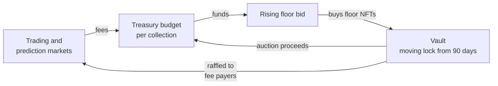

# FloorGuard

[](https://github.com/Goldcote/FloorGuard/actions/workflows/test.yml)

An NFT marketplace protocol that spends its own fees on buying the cheapest
tokens of the collections it trades.

> **Unaudited and experimental. Do not deploy with real funds.**
> The code has been through automated reviews only, not a professional audit.
> Games, the lottery and paid raffles are regulated or prohibited in many
> places. See [SECURITY.md](SECURITY.md).

Zero-royalty marketplaces reward sellers for undercutting each other.
FloorGuard has no listings to undercut, and the part of each fee that is not
paid to the NFT project (a project can be given up to half) becomes a budget
for buying the cheapest tokens of that collection. How much difference that
makes is modest: about one token bought for every fifty traded. See
[docs/ECONOMICS-REVIEW.md](docs/ECONOMICS-REVIEW.md).

**Start with the [FloorGuard v1 design paper](docs/FLOORGUARD-V1.md):** what it
is, why now, what it can and cannot do, the open problems and how to help. It is
also available as a designed
[PDF and Word file](https://github.com/Goldcote/FloorGuard/releases/tag/paper-v1).

**Try the [demo](https://goldcote.github.io/FloorGuard/):** the web app in demo
mode, in your browser. It is a simulation with play money and simulated time
running 600 times faster; no wallet or chain is needed.

The idea started as a
[2024 white paper](https://x.com/captainPURU/status/1825613065502462081) and
grew into the [v0.1 concept document](docs/WHITEPAPER-v0.1.md), kept as history.
This repository is the first implementation.

## How it works



1. **Marketplace.** Buyers post ETH offers on a token or on a whole collection,
   and holders accept. There are no listings to undercut. A 2% fee goes to the
   Treasury, and ERC-2981 royalties are paid up to a cap. A project can also be
   given a share of the fees its collection generates.
2. **Buyback.** The protocol quotes a standing bid for each collection. It rises
   over time until a holder sells into it, then steps down and rises again, so
   it finds the lowest price a holder will accept without an oracle. The bid is
   never more than the collection's budget can pay, and money that arrives late
   does not inherit a rise nobody could have been paid. The owner sets a maximum
   price.
3. **Vault.** Bought NFTs have a moving lock. From 90 days a daily random draw
   picks holdings to unlock, so nobody knows the date in advance. A picked
   holding unlocks only if the month's median floor is high enough (130% of its
   purchase price at 90 days, falling to 100% at a year), and at most 5% of a
   collection's holdings unlock in a week. Unlocked holdings are auctioned, with
   proceeds returning to the budget, or raffled. One purchase in five is instead
   raffled to players after 30 days, and raffle prizes vest for 30 days. Selling
   one returns about enough to buy one back, so auctions do not increase the
   number of tokens held; prizes return tokens to circulation.
4. **Prediction markets.** Anyone can bet on a collection's floor going up or
   down. 3% of winnings funds buybacks.
5. **Games.** Dice, coinflip and slots against a house bankroll, and a pooled
   lottery per collection. Half of the 2% edge on every wager and 5% of every
   lottery pot fund buybacks for the collection the player backs; the other half
   of the edge stays in the games bankroll, which anyone can fund for
   redeemable shares.
6. **Ticket raffles.** Anyone can raffle an NFT for paid tickets; 5% of ticket
   revenue funds buybacks.
7. **IP licensing.** Licences to use the artwork of NFTs held in the Vault, with
   the fees funding buybacks.
8. **Points and raffles.** Users earn points for the fees they generate. Points
   that have been activated before a draw are a user's weight in raffles of
   Vault NFTs. Points can be bought by trading with oneself; see
   [SECURITY.md](SECURITY.md).

[docs/ARCHITECTURE.md](docs/ARCHITECTURE.md) explains each contract and lists
where the code departs from the concept document. [docs/FAIRNESS.md](docs/FAIRNESS.md)
explains how the games' results can be checked.

## Status

| Part | State |
|---|---|
| Contracts in `src/` | Implemented, with unit, fuzz and invariant tests |
| Chainlink VRF adapter | Written, not tested against a live coordinator |
| Deployment | Local chain only; simulated on Base Sepolia, not broadcast. See [docs/TESTNET.md](docs/TESTNET.md) |
| Web app in `app/` | Every flow tested against a local chain with a built-in test account; not yet tested with a real browser wallet. Includes a demo mode that needs no wallet. See [app/README.md](app/README.md) |
| Keeper bot in `keeper/` | Tested end to end on a local chain; not run on a public network. See [keeper/README.md](keeper/README.md) |
| Reviews | Twelve automated review passes, an economics review and a front-end security review, recorded in [docs/AUDIT.md](docs/AUDIT.md). The latest changes to the games bankroll ("the house") have not been reviewed |
| Audit | None |

A governance token from the concept document is not built. The full list is at the end of the architecture document.

## Getting started

You need [Foundry](https://getfoundry.sh).

```bash
git clone --recurse-submodules https://github.com/Goldcote/FloorGuard.git
```

```bash
forge test
```

### Run it locally

Start a local chain in one terminal:

```bash
anvil
```

In another, deploy the protocol and a demo collection. The key below is anvil's
public test account, which only has funds on your local chain.

```bash
forge script script/Deploy.s.sol --rpc-url local --broadcast --private-key 0xac0974bec39a17e36ba4a6b4d238ff944bacb478cbed5efcae784d7bf4f2ff80
```

```bash
forge script script/SeedLocal.s.sol --rpc-url local --broadcast --private-key 0xac0974bec39a17e36ba4a6b4d238ff944bacb478cbed5efcae784d7bf4f2ff80
```

Addresses are written to `deployments/31337.json`.

Then run the web app against it:

```bash
cd app
```

```bash
npm install
```

```bash
npm run sync -- --local
```

```bash
npm run dev
```

and open http://localhost:5173. The app's own demo mode works without any
chain.

### Deploy to a testnet

Follow [docs/TESTNET.md](docs/TESTNET.md).

## Repository layout

```
src/            contracts
  oracles/      floor price oracles
  randomness/   randomness providers
test/           unit, fuzz, invariant and end-to-end tests
script/         deployment and local seeding
app/            web front end
keeper/         bot for the maintenance calls anyone may make
docs/           architecture and the original concept documents
```

## Contributing

Issues and pull requests are welcome; [CONTRIBUTING.md](CONTRIBUTING.md) says where to start. Please run `forge fmt` and `forge test`
(and, for changes in `app/` or `keeper/`, `npm test` there) before opening a
pull request, and add tests for behaviour you change. CI runs the same checks. Report
vulnerabilities privately, as described in [SECURITY.md](SECURITY.md).

## Supporting development

FloorGuard is built in the open and has no token, no team allocation and no
protocol fee for its developers. If you want to support the work, donations are
welcome at:

**`goldcote.eth`**

Check what the name resolves to yourself before sending anything. Donations go
to the developers, not to the protocol's Treasury, and buy nothing: no points,
no rights and no say over the protocol.

## Licence

[MIT](LICENSE)
