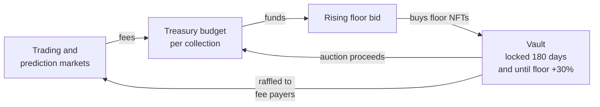

# FloorGuard

An NFT marketplace protocol that spends its own fees on buying the cheapest
tokens of the collections it trades.

> **Unaudited and experimental. Do not deploy with real funds.**
> See [SECURITY.md](SECURITY.md).

Zero-royalty marketplaces reward sellers for undercutting each other.
FloorGuard has no listings to undercut, and the part of each fee that is not
paid to the NFT project (a project can be given up to half) becomes a budget
for buying the cheapest tokens of that collection. How much difference that
makes is modest: about one token bought for every fifty traded. See
[docs/ECONOMICS-REVIEW.md](docs/ECONOMICS-REVIEW.md).

The idea started as a
[2024 white paper](https://x.com/captainPURU/status/1825613065502462081) and
grew into the [v0.1 concept document](docs/WHITEPAPER-v0.1.md). This repository
is the first implementation.

## How it works



1. **Marketplace.** Buyers post ETH offers on a token or on a whole collection,
   and holders accept. There are no listings to undercut. A 2% fee goes to the
   Treasury, and ERC-2981 royalties are paid up to a cap. A project can also be
   given a share of the fees its collection generates.
2. **Buyback.** The protocol quotes a standing bid for each collection. It rises
   over time until a holder sells into it, then steps down and rises again, so
   it finds the lowest price a holder will accept without an oracle. The bid is
   never more than the collection's budget can pay, and it only rises while the
   budget covers it. The owner sets a maximum price.
3. **Vault.** Bought NFTs are locked for at least 180 days and until the floor is
   30% above the purchase price. They are then auctioned, with proceeds returning
   to the budget, or raffled. If the floor never gets there they stay locked
   unless the owner releases them. Selling one returns about enough to buy one
   back, so auctions do not increase the number of tokens held.
4. **Prediction markets.** Anyone can bet on a collection's floor going up or
   down. 3% of winnings funds buybacks.
5. **Games.** Dice, coinflip and slots against a house bankroll, and a pooled
   lottery per collection. The 2% edge on every wager and 5% of every lottery
   pot fund buybacks for the collection the player backs.
6. **Ticket raffles.** Anyone can raffle an NFT for paid tickets; 5% of ticket
   revenue funds buybacks.
7. **IP licensing.** Licences to use the artwork of NFTs held in the Vault, with
   the fees funding buybacks.
8. **Points and raffles.** Users earn points for the fees they generate. Points
   that have been activated before a draw are a user's weight in raffles of
   Vault NFTs. Points can be bought by trading with oneself; see
   [SECURITY.md](SECURITY.md).

[docs/ARCHITECTURE.md](docs/ARCHITECTURE.md) explains each contract and lists
where the code departs from the concept document. [docs/FAIRNESS.md](docs/FAIRNESS.md)
explains how the games' results can be checked.

## Status

| Part | State |
|---|---|
| Contracts in `src/` | Implemented, with unit, fuzz and invariant tests |
| Chainlink VRF adapter | Written, not tested against a live coordinator |
| Deployment | Local chain only; simulated on Base Sepolia, not broadcast. See [docs/TESTNET.md](docs/TESTNET.md) |
| Web app in `app/` | Reads and transactions tested against a local chain; not yet tested with a browser wallet. See [app/README.md](app/README.md) |
| Audit | None |

A governance token from the concept document is not built. The full list is at the end of the architecture document.

## Getting started

You need [Foundry](https://getfoundry.sh).

```bash
git clone --recurse-submodules https://github.com/Goldcote/FloorGuard.git
```

```bash
forge test
```

### Run it locally

Start a local chain in one terminal:

```bash
anvil
```

In another, deploy the protocol and a demo collection. The key below is anvil's
public test account, which only has funds on your local chain.

```bash
forge script script/Deploy.s.sol --rpc-url local --broadcast --private-key 0xac0974bec39a17e36ba4a6b4d238ff944bacb478cbed5efcae784d7bf4f2ff80
```

```bash
forge script script/SeedLocal.s.sol --rpc-url local --broadcast --private-key 0xac0974bec39a17e36ba4a6b4d238ff944bacb478cbed5efcae784d7bf4f2ff80
```

Addresses are written to `deployments/31337.json`.

### Deploy to a testnet

Follow [docs/TESTNET.md](docs/TESTNET.md).

## Repository layout

```
src/            contracts
  oracles/      floor price oracles
  randomness/   randomness providers
test/           unit, fuzz, invariant and end-to-end tests
script/         deployment and local seeding
app/            web front end
docs/           architecture and the original concept documents
```

## Contributing

Issues and pull requests are welcome. Please run `forge fmt` and `forge test`
before opening a pull request, and add tests for behaviour you change. Report
vulnerabilities privately, as described in [SECURITY.md](SECURITY.md).

## Supporting development

FloorGuard is built in the open and has no token, no team allocation and no
protocol fee for its developers. If you want to support the work, donations are
welcome at:

**`goldcote.eth`**

Check what the name resolves to yourself before sending anything. Donations go
to the developers, not to the protocol's Treasury, and buy nothing: no points,
no rights and no say over the protocol.

## Licence

[MIT](LICENSE)
