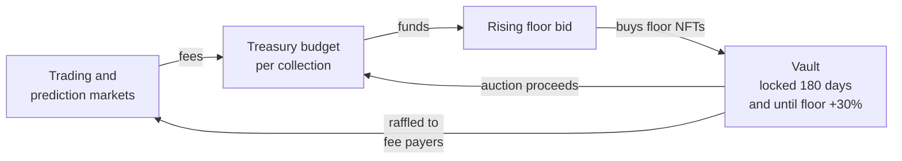

# FloorGuard

An NFT marketplace protocol that turns its own fees into floor price support.

> **Unaudited and experimental. Do not deploy with real funds.**
> See [SECURITY.md](SECURITY.md).

Zero-royalty marketplaces reward sellers for undercutting each other, and
collection floors bleed as a result. FloorGuard reverses the incentive: every
fee the protocol earns on a collection becomes a budget for buying that
collection's floor.

The idea started as a
[2024 white paper](https://x.com/captainPURU/status/1825613065502462081) and
grew into the [v0.1 concept document](docs/WHITEPAPER-v0.1.md). This repository
is the first implementation.

## How it works



1. **Marketplace.** Buyers post ETH offers on a token or on a whole collection,
   and holders accept. There are no listings to undercut. A 2% fee goes to the
   Treasury, and ERC-2981 royalties are paid up to a cap.
2. **Buyback.** The protocol quotes a standing bid for each collection. It rises
   over time until a holder sells into it, then steps down and rises again, so it
   finds the floor without an oracle.
3. **Vault.** Bought NFTs are locked for at least 180 days and until the floor is
   30% above the purchase price. They are then auctioned, with proceeds returning
   to the budget, or raffled.
4. **Prediction markets.** Anyone can bet on a collection's floor going up or
   down. 3% of winnings funds buybacks.
5. **Points and raffles.** Users earn points for the fees they generate. Points
   are their odds of winning NFTs raffled from the Vault.

[docs/ARCHITECTURE.md](docs/ARCHITECTURE.md) explains each contract and lists
where the code departs from the concept document.

## Status

| Part | State |
|---|---|
| Contracts in `src/` | Implemented, with unit, fuzz and invariant tests |
| Chainlink VRF adapter | Written, not tested against a live coordinator |
| Deployment | Local chain only; no testnet or mainnet deployment exists |
| Web app in `app/` | Early; see [app/README.md](app/README.md) |
| Audit | None |

Casino games, IP licensing and a governance token from the concept document are
not built. The full list is at the end of the architecture document.

## Getting started

You need [Foundry](https://getfoundry.sh).

```bash
git clone --recurse-submodules https://github.com/Goldcote/FloorGuard.git
```

```bash
forge test
```

### Run it locally

Start a local chain in one terminal:

```bash
anvil
```

In another, deploy the protocol and a demo collection. The key below is anvil's
public test account, which only has funds on your local chain.

```bash
forge script script/Deploy.s.sol --rpc-url local --broadcast --private-key 0xac0974bec39a17e36ba4a6b4d238ff944bacb478cbed5efcae784d7bf4f2ff80
```

```bash
forge script script/SeedLocal.s.sol --rpc-url local --broadcast --private-key 0xac0974bec39a17e36ba4a6b4d238ff944bacb478cbed5efcae784d7bf4f2ff80
```

Addresses are written to `deployments/31337.json`.

### Deploy to a testnet

Copy `.env.example` to `.env`, fill in the RPC URL and the Chainlink VRF
settings, then:

```bash
forge script script/Deploy.s.sol --rpc-url base_sepolia --broadcast --account <your-keystore-account>
```

If `OWNER` is set to another address, that address must call `acceptOwnership()`
on each contract.

## Repository layout

```
src/            contracts
  oracles/      floor price oracles
  randomness/   randomness providers
test/           unit, fuzz, invariant and end-to-end tests
script/         deployment and local seeding
app/            web front end
docs/           architecture and the original concept documents
```

## Contributing

Issues and pull requests are welcome. Please run `forge fmt` and `forge test`
before opening a pull request, and add tests for behaviour you change. Report
vulnerabilities privately, as described in [SECURITY.md](SECURITY.md).

## Licence

[MIT](LICENSE)
