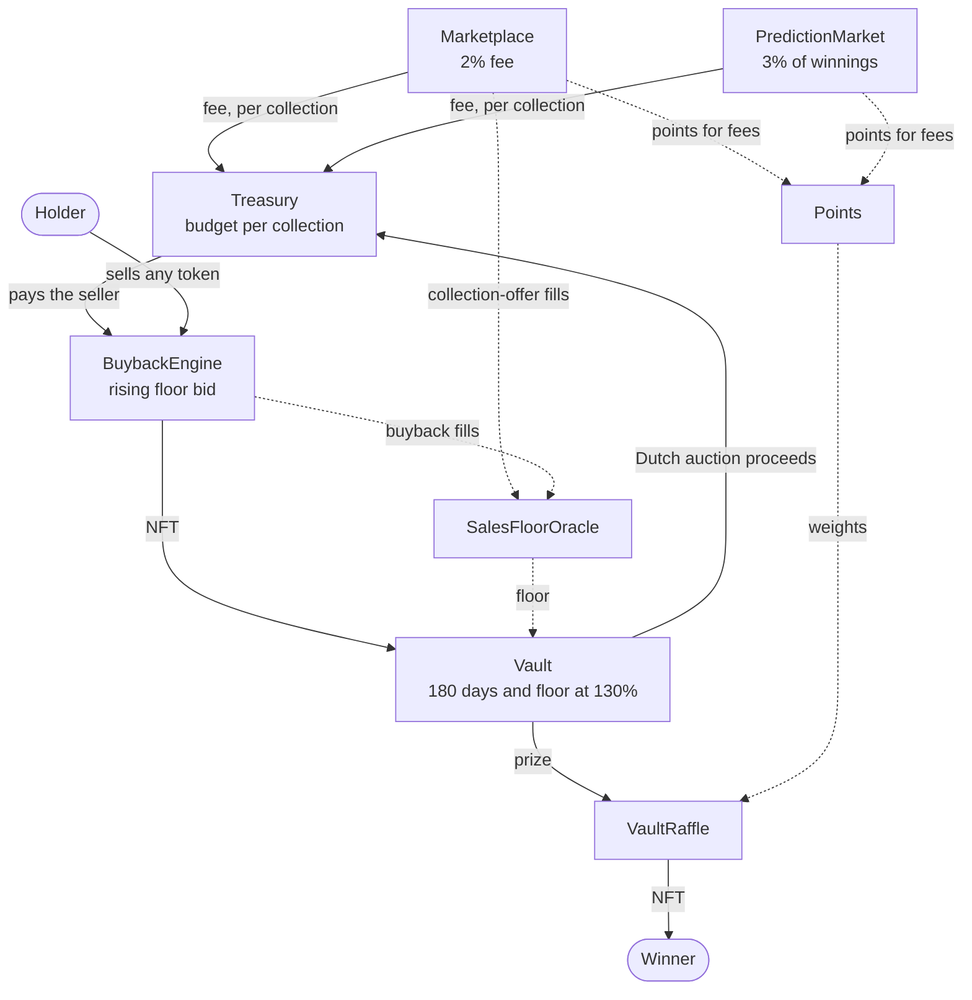

# Architecture

This document describes what the contracts in `src/` do today. The original
concept documents are kept for history in
[WHITEPAPER-v0.1.md](WHITEPAPER-v0.1.md); where the two differ, this file and the
code are right. The differences are listed at the end.

## Contracts

| Contract | Role |
|---|---|
| `Marketplace` | Escrowed ETH offers on one token or on any token of a collection. A holder accepts to swap. 2% fee to the Treasury, ERC-2981 royalties honoured up to a cap. |
| `Treasury` | Holds fees as a separate buyback budget per collection, after an optional share for the NFT project. Only the BuybackEngine can spend. |
| `BuybackEngine` | Quotes a standing bid per collection that rises until a holder sells into it. Pays from the collection's budget and sends the NFT to the Vault. |
| `Vault` | Locks bought NFTs. Unlock needs 180 days and a floor at 130% of the purchase price. Then raffle, relock or Dutch auction. |
| `PredictionMarket` | Pooled higher/lower bets on a collection's floor. 3% fee on winnings to the Treasury. |
| `Games` | Dice and coinflip against a house bankroll. The edge on each wager goes to the Treasury. |
| `TicketRaffle` | Anyone raffles an NFT for paid tickets. 5% of ticket revenue goes to the Treasury. |
| `IPLicenseManager` | Sells time-limited licences for NFTs held in the Vault. Licence fees go to the Treasury. |
| `Points` | Non-transferable points earned per ETH of fees generated. Raffle weights. |
| `VaultRaffle` | Raffles vault NFTs to points holders using a randomness provider. |
| `SalesFloorOracle` | Floor from the protocol's own floor-type sales (lower median of the last 7). |
| `PushFloorOracle` | Floor pushed by trusted reporters from off-chain data. |
| `ChainlinkVRFRandomness` | Adapter from the randomness interface to Chainlink VRF v2.5. |



## Marketplace

There are no listings. A buyer escrows ETH in an offer, either for one token
(`makeOffer`) or for any `quantity` tokens of a collection
(`makeCollectionOffer`). A holder calls `acceptOffer(offerId, tokenId,
minProceeds)` and the swap is atomic. The offerer can cancel the unfilled part at
any time.

On each sale the price is split three ways:

- **Fee** (`feeBps`, default 2%, hard cap 5%) goes to the Treasury as budget for
  that collection.
- **Royalty** is read from ERC-2981 and truncated at `royaltyCapBps` (default 5%,
  hard cap 10%). If the receiver cannot take ETH, the royalty goes to the
  collection's budget instead.
- **The rest** goes to the seller. `minProceeds` protects the seller from a fee
  or royalty change between signing and inclusion.

Any ERC-721 contract can be traded, but only collections the owner marks as
supported take part in the flywheel. For an unsupported contract the fee goes to
the Treasury's unallocated pool, no points are earned and no sale is recorded in
the oracle. This stops someone deploying a throwaway collection to farm points.

## Treasury and budgets

Fees are not pooled. `deposit(collection)` credits that collection's budget, so
trading a collection funds the defence of that collection's floor and one
collection cannot spend another's fees. ETH sent without a collection sits in
`unallocated` until the owner assigns it with `allocate`.

### Where the money sits

| Pot | Filled by | Leaves to | Who decides |
|---|---|---|---|
| Collection budget (`budgetOf`) | Fees on that collection, vault auction proceeds, donations | Holders who sell into the floor bid | Nobody per payment; the owner sets the bid curve |
| Project share (`owedTo`) | The owner-set share of a collection's fees, at most 50% | The project's recipient address, when it claims | The owner sets recipient and share |
| Unallocated | Plain ETH transfers, fees from unsupported collections, withdrawn games bankroll | A collection budget | The owner, with `allocate` |
| Games bankroll | Anyone, with `fundBankroll`; losing stakes | Winning players, or the Treasury's unallocated pool | The owner can only move it to the Treasury |
| Marketplace escrow | Open offers | The seller on acceptance, or back to the offerer | The offerer and the seller |
| Prediction pools | Bets | Winners, or refunds when void | The oracle price |
| Ticket raffle revenue | Ticket sales | The raffle's creator, 5% to the Treasury, or refunds | The raffle outcome |

There is no team wallet, staking pool or token. Vault auction proceeds are
recycled capital and are not split with the project.

### Who controls it

Every contract has one `owner`, set at deployment. The owner cannot withdraw from
the Treasury, but it chooses the spender, the oracles and the randomness
providers, so it has to be fully trusted. Each NFT project can also deploy its
own instance of the protocol and be its own owner.

What the owner is, is the deployer's choice, and the contracts do not care:

- a single wallet, which is fine for a testnet and nothing else;
- a multisig, by setting `OWNER`;
- a multisig behind a timelock, by also setting `TIMELOCK_DELAY`. The deploy
  script then creates an OpenZeppelin `TimelockController` that owns every
  contract, with `OWNER` as its only proposer and executor, so each owner action
  is public for the delay before it can run.

Ownership transfers are two-step. `script/AcceptOwnership.s.sol` completes the
handover in either setup.

Adding a collection is an owner action: mark it supported on the Marketplace,
set its bid curve on the BuybackEngine, and optionally set a project share and
enable predictions and games. `script/AddCollection.s.sol` does all of it in one
run. After that, buybacks need no operator or bot: holders sell into the bid
themselves.

## BuybackEngine: the rising bid

The engine needs to buy at the floor without being told what the floor is. For
each collection the owner configures a curve:

```
bid(t) = min(maxPrice, basePrice * (1 + growthBpsPerDay * elapsed / 1 day))
```

Any holder can call `sell(collection, tokenId, minPrice)` and is paid the current
bid from the collection's budget. After a fill the base price becomes the fill
price less `stepDownBps`, and the bid starts rising again.

The bid starts below the market. Holders compete to be the first to accept once
it reaches the lowest price any of them will take, which is the floor. No oracle
is involved, and a manipulated oracle cannot make the engine overpay. Anyone can
also buy the cheapest listing on another venue and sell it into the bid, which is
how the bid supports floors elsewhere.

The owner's `maxPrice` is the only guard against overpaying; see
[SECURITY.md](../SECURITY.md).

## Vault

Each buyback creates a holding with its purchase price and time.

- `unlock` is permissionless and succeeds when the lock time has passed **and**
  the oracle floor is fresh and at least 130% of the purchase price.
- The owner can `governanceUnlock` early, or `relock` to extend.
- Once unlocked, the owner can `sendToRaffle` or `startAuction`. If the owner
  does nothing for 30 days, anyone can start the auction.
- The Dutch auction runs from 150% of the reserve down to the reserve over three
  days and then holds. The reserve is the oracle floor, but never less than the
  unlock price (130% of the purchase price), so a manipulated oracle cannot make
  the Vault sell cheaply. An auction that ran out without a buyer can be
  restarted by anyone at fresh prices. Proceeds go to the collection's budget.
- `startAuctionWithPrices` lets the owner sell below the reserve, for example to
  exit a collection that has collapsed or whose oracle is dead.

## PredictionMarket

Anyone can open a market on a supported collection. The floor is snapshotted at
creation, betting is open for `bettingPeriod` (at most half of `duration`), and
the market settles on a floor price published at or after `duration`. A price
from before the settlement time is never accepted, so nobody can bet on the
price the market will settle on.

- Winners split the losing pool in proportion to their stake. The fee is taken
  from their winnings, not their stake.
- A market is void, with full refunds, if one side has no bets, the price is
  unchanged, or the oracle has no fresh price for three days after settlement.

## Games

`Games` is one dice game: the player picks a chance of winning from 1% to 95%,
and a coinflip is a 50% roll. The edge (default 2%) is taken from the wager and
paid to the Treasury as a fee for the collection the player chose to back. The
rest is played at fair odds against the house bankroll, so the bankroll has no
expected gain or loss and the whole house take funds buybacks.

The house's side of each bet is set aside when the bet is placed, so every
outcome can always be paid. One bet can risk at most 1% of the free bankroll and
all open bets together at most 20% of the house's funds. A bet whose randomness
has not arrived within a day is refunded, and randomness that arrives later than
that is ignored, so nobody can choose between a late result and a refund. The bankroll can only
leave to winning players or to the Treasury.

Each bet costs the operator one randomness request, which on Ethereum mainnet is
likely to exceed the fee on a small wager. Set `minBet` accordingly.

## Ticket raffles

`TicketRaffle` lets anyone raffle an NFT they own, from a collection the owner
has approved. The creator sets a ticket price, a minimum and maximum number of
tickets and a duration, and the NFT is held in escrow. When the raffle ends,
anyone can `close` it:

- if the minimum was reached and the ticket revenue is at least `minPot`, a
  random ticket wins the NFT, the creator receives the ticket revenue and 5%
  goes to the collection's buyback budget;
- if not, every buyer can take a refund and the creator can reclaim the NFT.

The creator can cancel only while no ticket has been sold, and the fee is fixed
when the raffle is created. Late randomness is ignored, as in the other modules.

Buyers can always reach either a draw or a refund. If a raffle cannot finish,
because its randomness never arrives or the NFT cannot be transferred, anyone
can `abort` it into refunds a week after its end, or a week after the winner
was drawn if nobody could settle it.

## IP licensing

`IPLicenseManager` sells time-limited licences for the artwork of NFTs held in
the Vault. The owner defines numbered tiers per collection, each with a price
and a duration. The licence fee goes to the Treasury as a fee for that
collection. Only locked holdings can be licensed. A licence stops being valid
when its term ends, when the owner revokes it, or when the NFT goes to auction
or leaves the Vault, which can happen before the term is up. A revoked licensee
cannot buy another licence for that holding until the owner lifts the ban.

The contract records who paid for which licence and nothing more. Whether the
Vault may sublicense a collection's artwork depends on that collection's own
terms, and the licence text has to exist off-chain.

## Points and raffles

Points are credited per ETH of **fees that reach the buyback budget**, not per
ETH of volume, at a rate set per module. A project's share of a fee earns no
points. On the Marketplace both buyer and seller are credited for
the sale's fee, and in Games the player is credited for the edge on each wager. On the PredictionMarket winners are credited for the fee they
pay, and losers for the fee their stake funded. Because points follow fees,
farming them always pays into buyback budgets.

Earning points is a single storage write to `pendingOf`, which keeps trades
cheap enough for Ethereum mainnet. Pending points do not count in raffles until
they are activated with `flush(user)`, which anyone can call for anyone. The
seven-day announce period before each draw is the time to do it.

Activated balances are the leaves of a 16-ary sum tree, six levels deep (about
16.7 million holders). Activating writes seven slots. Picking the holder of a
random point reads at most 96 slots and never loops over users.

`VaultRaffle.draw` requests randomness once the seven-day announce period has
passed, and freezes point weights until the randomness arrives. Points cannot be
activated in that window, so they count from the next raffle. Without the
freeze, anyone who saw the random word before it landed could add just enough
points to steer the result. The winner keeps 20% of their points. Randomness
that arrives more than a day late resets the draw instead of picking a winner,
a request abandoned through `resetDraw` is never accepted later, and a reset
draw cannot be requested again for an hour.

## Oracles

Both implement `IFloorOracle.floorPrice(collection) -> (price, updatedAt)` and
revert when they have no price. Consumers apply their own staleness limit.

- `SalesFloorOracle` records only floor-type sales: collection-offer fills and
  buyback fills. In both, the seller chooses which token to give up, so the price
  reflects the cheapest token. Sales of specific tokens are ignored because they
  may be rares.
- `PushFloorOracle` stores what its reporters push.

Deployed defaults: the Vault reads the sales oracle and the PredictionMarket
reads the push oracle.

## Differences from the v0.1 whitepaper

| Whitepaper | Code | Why |
|---|---|---|
| Engine "accepts an offer" to buy | Engine quotes a rising bid that holders sell into | The marketplace has bids only, so there was nothing for the engine to buy from |
| Treasury triggers a buyback inside `receive()` | Buybacks happen when a holder calls `sell` | Every fee payment would have carried the gas and reentrancy risk of a purchase |
| One shared treasury | A budget per collection | Fees from a collection defend that collection |
| Chainlink NFT floor feeds, Reservoir | Pluggable oracle with two implementations | Avoids depending on one external feed |
| Points per ETH of volume | Points per ETH of fees | Volume can be wash traded for free in some modules; fees cannot |
| Snapshot of points at raffle time | Weights frozen from the draw request until randomness arrives | Same effect as a snapshot without copying every balance |
| Royalties not mentioned | ERC-2981 honoured, capped | The 2024 paper's starting point was zero-royalty venues |

## Chains

The contracts are plain Solidity 0.8.28 compiled for the Cancun EVM, pay in
native ETH and trade standard ERC-721 tokens. They deploy unchanged to Ethereum
mainnet and to EVM rollups such as Base, Arbitrum and Optimism. The largest
contract is about 7 KB, well under the 24 KB limit.

## Not built yet

- Slots and lotteries
- Revenue-share and exclusive licences
- A governance token; the owner is a single address, meant to be a multisig
- Burning vault NFTs
- Streak, referral and daily bonuses for points
- A share of prediction fees for the NFT project
- AI or bot strategies and pooled strategies from the 2024 paper
- The desktop (Tauri) shell around the web app
