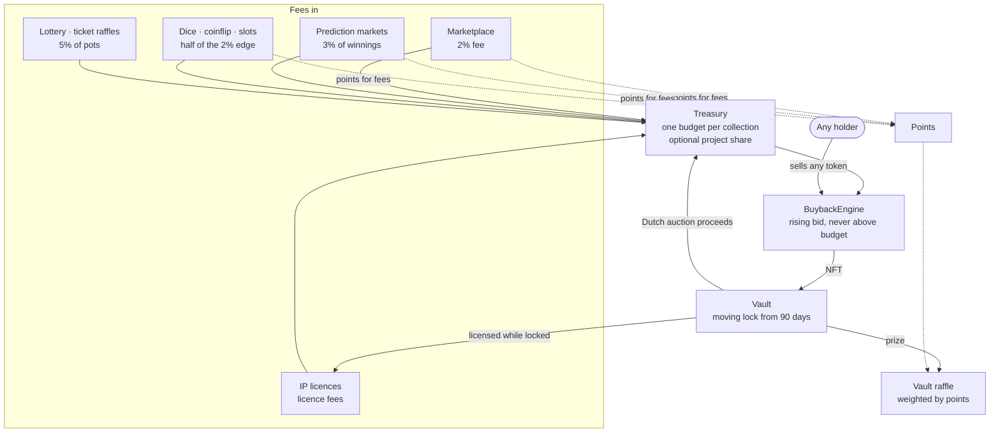

# FloorGuard v1

### An open, fee-funded buyer of last resort for NFT collections, and an invitation to build it

*Design paper, October 2026. Supersedes the [v0.1 concept draft](WHITEPAPER-v0.1.md) as the description of
what FloorGuard is. Every mechanism described here exists in this repository; every figure is sourced to a
test, a model or a review in it.*

> **Status, stated first.** The code is an unaudited prototype. Nothing is deployed to a public network.
> It has been through twelve automated (AI) review passes, an economics review and a front-end security
> review, all recorded in [AUDIT.md](AUDIT.md). That is not a professional audit. The games, the lottery and
> paid raffles are regulated or prohibited in many places. This paper is written for people who might help
> build it, not for anyone deciding whether to put money in. There is no token today and nothing to buy.

---

## Contents

1. [Summary](#1-summary)
2. [Why now](#2-why-now)
3. [The problem, stated precisely](#3-the-problem-stated-precisely)
4. [Design principles](#4-design-principles)
5. [The system](#5-the-system)
6. [The rising bid: buying the floor without being told what it is](#6-the-rising-bid)
7. [The Vault: holding, releasing and lending what was bought](#7-the-vault)
8. [Engagement modules: more fee sources, and their costs](#8-engagement-modules)
9. [Fairness: what "provably fair" means here](#9-fairness)
10. [What it can and cannot do](#10-what-it-can-and-cannot-do)
11. [Security, control and the review record](#11-security-control-and-the-review-record)
12. [Running it: chains, costs and the minimum viable deployment](#12-running-it)
13. [Open problems](#13-open-problems)
14. [Roadmap](#14-roadmap)
15. [How to contribute](#15-how-to-contribute)
16. [Appendices](#16-appendices)

---

## 1. Summary

NFT floors have been bleeding for years. Part of the cause is structural: the dominant trading venues paid
people, in points and tokens, to list lower and trade faster, and stopped paying the creators whose
collections they traded. FloorGuard asks a narrow question: **what if the venue's own fees were spent on
the other side of the trade?**

FloorGuard is a set of contracts that does exactly that and nothing more ambitious:

- **A marketplace without listings.** Buyers post ETH offers on a token or on a whole collection; holders
  accept. With no order book of asks, there is no race to list lowest. A 2% fee is charged and ERC-2981
  royalties are honoured up to a cap.
- **A budget per collection.** Every fee earned on a collection, less an optional share for its creators,
  becomes that collection's buyback budget. One collection never spends another's fees.
- **A standing floor bid.** For each collection the protocol quotes a bid that rises slowly until a holder
  sells into it, then steps down and rises again. It finds the lowest price a holder will accept without an
  oracle, and it can never bid more than its budget holds.
- **A vault with a moving lock.** What the bid buys is locked for at least 90 days, then unlocks on a day
  chosen by a daily random draw that nobody can predict, only once the month's median floor is up to 30%
  above the price paid, and never more than 5% of a collection in a week. Then it is auctioned (proceeds
  return to the budget), raffled to the people whose fees
  bought it, or lent out as licensed artwork.
- **Optional engagement modules** (prediction markets, dice, slots, a lottery, ticket raffles and a
  community "house" that funds the games) exist to bring in more fees, and each carries costs and risks
  that this paper states plainly.

What we learned building and reviewing it is as important as what we built. The honest headline from our
own economics review is that **the buyback takes about one token off the market for every fifty traded on
FloorGuard**; with one purchase in five raffled to players, about one in sixty-two stays off it. That is real, permanent, programmatic demand on the bid side, but it is second-order unless
FloorGuard carries a large share of a collection's trading. FloorGuard is therefore most meaningful as **a
community-owned home venue for collections whose holders choose to trade there**, at a moment when the
largest zero-royalty venue is closing its doors. That is the opportunity this paper is about.

---

## 2. Why now

**The market that FloorGuard was designed against is winding down.** On 12 October 2026, Blur announced
that it will close its website on 12 November 2026; its on-chain marketplace contracts keep running, and
Blend, its NFT lending product, stops matching new loans on the same date. According to The Block, Blur's
monthly trading volume fell from about $1.43 billion in March 2023 to under $7 million in March 2026.
([The Block, 12 Oct 2026](https://theblock.co/news/ecosystems/2026-10-12-blur-nft-marketplace-shutting-down-frontend-blend-418363))

The rest of the landscape points the same way. OpenSea answered Blur in 2023
with OpenSea Pro, a zero-fee marketplace with rewards
([Decrypt](https://decrypt.co/125410/opensea-no-fee-pro-marketplace-nft-rewards)),
and announced a SEA token for the first quarter of 2026 with half of platform
revenue earmarked for buying back that token
([The Block](https://theblock.co/post/375195/opensea-sets-sea-token-launch-for-q1-2026-with-50-of-revenue-at-launch-earmarked-for-buybacks));
in March 2026 it delayed the launch with no new date
([The Block](https://www.theblock.co/post/393824/opensea-delays-sea-token-launch-offers-no-new-date)).
Abstract, the Ethereum layer 2 built by Pudgy Penguins' parent company, announced
on 6 October 2026 that it will shut down on 15 December, a week after Blast
announced its own closure
([CryptoTicker](https://cryptoticker.io/en/abstract-chain-shutdown-withdraw-funds/)).

FloorGuard is the opposite bet to all of these. It pays no rewards for listing
or volume, does not spend its fees buying back a token of its own, and spends
what it earns on the collections that earned it: a venue's revenue buying the
floor of the NFTs traded there, not the venue's own token.

Three things follow, and they are the reason this is a good moment to build in the open:

1. **Holders need somewhere to trade.** Most people trade through a website, not contracts. Volume has to
   go somewhere, and communities that move together can choose where.
2. **The incentive experiment has run its course.** Points-for-listings produced volume while the points had
   value and floors that bled while they did. The case for a venue whose incentives point the other way no
   longer needs to be argued from theory.
3. **There is room for something small and honest.** A protocol that sells nothing, promises no yield and
   no price, and publishes its own review record, is a different proposition from what the last cycle offered.

FloorGuard began as a [2024 thread](https://x.com/captainPURU/status/1825613065502462081) proposing a "DeFi
primitive to counter zero-royalty NFT trading venues and preserve NFT floors". This paper is what that idea
became once it had to be written down as code and survive review.

---

## 3. The problem, stated precisely

A collection's **floor** is the cheapest price at which anyone will sell a token. It matters beyond its own
number: it sets the cost of joining a community, the collateral value of every token in it, and the mood
of its holders. Three forces push it down.

- **Asks compete, bids don't.** On a listing-based venue, a seller who wants out undercuts the lowest ask.
  Each undercut becomes the new reference price. Bids are thinner and quieter.
- **Venues paid for undercutting.** Point programmes rewarded listing at or below the floor and trading
  volume regardless of price. Holders sold into each other to farm rewards, and the rewards were often
  worth less than the floor they gave up.
- **Fees left the ecosystem.** Zero-royalty trading removed the creators' income, and venue fees went to
  venue operators. Nothing from the trading of a collection flowed back to that collection.

**What a protocol can and cannot do about it.** No contract can create demand for art people don't want.
What a protocol *can* do is decide where its own fees go and remove its own incentives to undercut. That is
the whole of FloorGuard's claim: its fees become standing demand for the collection that paid them, and
its design gives nobody a reason to list lower. Everything else in this paper is about doing that well,
safely, and without pretending it does more.

---

## 4. Design principles

These were not all obvious at the start. Several were learned from reviews that broke an earlier version.

1. **No asks to undercut.** Trading is offer-and-accept. Sellers choose a bid; nobody posts a lower price
   for others to beat.
2. **Fees are earmarked, never pooled.** Each collection has its own budget. Trading a collection funds
   that collection.
3. **Buy without an oracle.** A bid that discovers the price by rising until someone takes it cannot be
   misled by a manipulated price feed. (Section 6.)
4. **Never bid money you don't have.** A bid the budget cannot pay is not a bid. This single rule came from
   the economics review and changed the engine's behaviour more than any other.
5. **No token today, no yield, no forecast.** The protocol runs on ETH. Nothing in this repository creates
   a token, and nothing presents returns. Whether FloorGuard should ever have one, such as the $FLOOR of
   the [v0.1 concept](WHITEPAPER-v0.1.md), is an open question (section 13), not a plan. Today every fee buys
   the floor of the collection that paid it.
6. **Randomness you can check.** Every draw and bet is settled by Chainlink VRF, whose proofs are verified
   on-chain, and every result can be recomputed from public data. (Section 9.)
7. **Anyone can keep it running.** Every maintenance action (settling markets, drawing raffles, unlocking
   holdings, refunding late bets) is permissionless. A reference bot is included.
8. **The owner is trusted, so make the owner slow and visible.** One owner configures everything. It should
   be a multisig behind a timelock; the deploy script can create the timelock. (Section 11.)
9. **Publish what is wrong.** The review record, the economics review and the security notes are part of
   the product.

---

## 5. The system



| Contract | What it does | Key parameters (defaults) |
|---|---|---|
| `Marketplace` | Escrowed offers on a token or a collection; accept to swap | Fee 2% (cap 5%); royalty cap 5% (max 10%) |
| `Treasury` | Per-collection budgets; project share; unallocated pool | Project share up to 50% |
| `BuybackEngine` | The rising floor bid | Growth 10%/day; step-down 15%; min bid 10% of base; owner-set cap |
| `Vault` | Holds buybacks; daily unlock draw, auction, raffle, licence | From 90 days, 0.5–5% daily chance; median floor 130% → 100% of cost; 5% a week; 1 in 5 to players; auction opens at 16× reserve, halves daily |
| `PredictionMarket` | Pooled higher/lower bets on a floor | Fee 3% of winnings; 2% dead band; betting ≤ 1/10 of the market's life |
| `Games` | Dice, coinflip, slots against a bankroll; house shares | Edge 2% (half kept by the bankroll); per-bet and total limits |
| `Lottery`, `TicketRaffle` | Pooled ETH rounds; NFT raffles with paid tickets | Fee 5%; minimum pot; refunds when stuck |
| `VaultRaffle`, `Points` | Raffles vault NFTs to fee payers | 2,500 points per ETH of fee; winner keeps 20%; prizes vest 30 days |
| `IPLicenseManager` | Time-limited licences for vault NFTs' artwork | Owner-defined tiers |
| `SalesFloorOracle`, `PushFloorOracle` | Floor prices for unlocks and markets | 7-sale lower median; trusted reporters |
| `ChainlinkVRFRandomness` | Verifiable randomness | One adapter per consumer |

Every contract has full reference documentation in [ARCHITECTURE.md](ARCHITECTURE.md).

---

## 6. The rising bid

*The heart of FloorGuard: how to spend a budget on the cheapest tokens of a collection without knowing the
price, without an oracle anyone can move, and without overpaying.*

### 6.1 The mechanism

For each collection the engine keeps a **curve**:

```
curve(t) = min( maxPrice , base × (1 + growth × days since restart) )
bid(t)   = min( curve(t) , budget of the collection )
```

Any holder can sell any token of the collection into the bid at any time. Holders compete: the first
willing seller takes the bid when it reaches their reservation price, so the engine buys at roughly the
lowest price anyone will accept, the floor, without being told what that is. After a sale the curve
restarts one step below the sale price and begins to rise again.

### 6.2 What the first design got wrong

The first version let the curve keep rising while the budget was empty. Our economics review showed that
unless fees arrive faster than a threshold (about 95 floors of trading a day at the original defaults),
**every purchase was dearer than the last until the engine paid its cap every time**. In the model, a
collection with modest volume paid twice the floor on every buy. Nothing was "wrong" in the code; the
mechanism was.

### 6.3 The rules that fixed it

| Rule | Why |
|---|---|
| **The bid is never more than the budget can pay.** | With a thin budget the bid *is* the budget, rising as fees arrive; a sale happens when it reaches the cheapest seller. |
| **Late money does not inherit a rise nobody could have been paid.** When a budget grows, the Treasury notifies the engine; if the budget could not cover the curve, the curve restarts from the higher of its base and the old budget. | Lumps of money (auction proceeds, donations) start where the bid really was. A deposit never lowers the bid. |
| **The base follows a falling market.** A budget-limited sale pulls the base down by up to three steps. | Without it, a stale base above a fallen market overpaid by up to 1.8× in simulation; with it, 1.01×. |
| **No bid below a minimum** (10% of the current base). | A nearly empty budget cannot buy a token for dust from a seller who named no minimum. |
| **The cooldown must be shorter than the regrow time.** | A longer pause lets every sale land above the one before. |
| **A guardian can only lower prices or pause.** | A fast key for a crash, while the owner sits behind a timelock. |

### 6.4 How well it works

An independent review simulated a year of hourly trading against the real contracts, with sellers who
accept at the floor:

| Scenario | Average paid / floor |
|---|---|
| Steady fee inflow, 0.02 to 0.5 floors a day | 1.002 |
| Market falling 70% a year | 1.001 – 1.002 |
| Market rising 3× a year (cap set high enough) | 1.001 – 1.002 |
| 60 days unfunded, then a 30-floor lump | 1.002 |
| Floor falls 60% overnight, guardian lowers the bid | 1.002 (worst purchase 1.003) |
| Floor falls 60% overnight, nobody acts | 2.44 on the first purchase, then the floor |
| One patient seller who owns the supply | 1.17 – 1.34 (cap at 1.5) |

The last two rows are the honest limits: a gap-down crash needs a human (or the guardian) to act, and a
collection dominated by one holder can be milked up to the cap. Both are documented in
[SECURITY.md](../SECURITY.md).

---

## 7. The Vault

Every token the engine buys is a **holding** with a purchase price and time.

### 7.1 A lock nobody can time

A fixed unlock date is a date traders can wait for; an unlock triggered by one oracle reading is a trigger
anyone can watch or push. The first design had both (180 days, then the oracle floor at 130%), and players
received nothing until a holding unlocked. The Vault now has a **moving lock**:

| Rule | Default | Why |
|---|---|---|
| **No unlock before 90 days.** | 90 days | Whatever the bid buys stays off the market for at least a quarter. |
| **A daily draw.** Once a day anyone can ask for a verifiable random word; it picks each eligible holding with a chance that rises with age. | 0.5% a day at 90 days, rising to 5% at a year | No unlock date is known before that day's draw. About two in three holdings that meet the floor condition unlock by six months, nearly all by a year. |
| **A floor that takes a month to move.** Anyone can record the floor once a day; the Vault reads the median of the last 30 days. | 30 daily samples, 15 needed | Moving it takes more than half a month of samples, not one moment. |
| **A required floor that falls with age.** | 130% of the price paid at 90 days, falling to 100% at a year | A holding bought near a peak is not locked forever once the market comes back, and the Vault never sells below cost. |
| **A weekly release cap.** | 5% of a collection's holdings a week, at least one | A rally cannot release a whole vintage at once. |
| **A players' share.** One purchase in five is set aside for players and raffled to points holders after 30 days. | 20%, owner-settable up to 50% | People who play and trade get something sooner. |
| **Prizes vest.** A raffle prize can be claimed 30 days after it is won. | 30 days | A token won for nothing is not dumped the same day. |

### 7.2 Release

- **By auction.** The Dutch auction opens at **16 times its reserve** and halves every day, resting at the
  reserve. The reserve is the highest of the oracle floor, the multiple the holding needed to unlock times
  its purchase price, and an owner minimum. The opening price is deliberately absurd: the sale price is
  found by buyers competing on the way down, so a manipulated oracle cannot make the Vault sell cheaply.
  (Two reviews broke earlier versions of this; see AUDIT.md.) **The Vault never sells below the floor, so an
  unlock is never a dump.**
- **By raffle.** The owner can raffle an unlocked holding, and the players' share goes to raffles on its
  own, to the people whose fees paid for it, weighted by points (section 8).
- **Licensing while locked.** Holdings can be licensed for use of their artwork, with fees returning to the
  budget. This is useful only for collections whose terms let holders sublicense.

A raffle winner cannot be restricted to selling on FloorGuard: an NFT in a wallet can be sold anywhere. The
vesting period is the protection, and every prize is a token back in circulation. That is the price of the
players' share, and section 10 counts it.

### 7.3 What the moving lock changes, and what it does not

A model of both rules on the economics review's price paths (`test/econ/sim_moving_lock.py`; 10,000 sales a
year, 25% on FloorGuard, three years, 40 runs):

| | Fixed lock | Moving lock |
|---|---|---|
| Most tokens returned to circulation in one week | 5 to 20 | 2 to 5 |
| Unlock date known in advance | Yes | No |
| Tokens off the market after three years | 147 to 149 | 102 to 117 |
| Held over a year and still locked, flat calm market | 51% | 39% |
| Held over a year and still locked, falling 60% a year | 61% | 59% |

**What the Vault cannot do,** from the economics review: recycling never increases the number of tokens off
the market (an auction funds about 0.98 of a replacement), and in a falling market most holdings never get
back to what was paid, so they stay locked; a falling threshold cannot change that. The Vault is a lock, not
an investment fund.

---

## 8. Engagement modules

The core loop needs volume. These modules exist to create fee income and give communities something to do
together. Each is optional, and each has a cost that is stated here rather than discovered later.

| Module | What it is | Fee to the collection's budget | The cost or risk |
|---|---|---|---|
| **Prediction markets** | Pooled bets on a floor going higher or lower | 3% of winnings | Later bettors know more; needs a trustworthy price reporter and a keeper to settle on time |
| **Dice, coinflip, slots** | Single-roll games against a house bankroll; stake played at exactly fair odds | Half of the 2% edge | Gambling regulation; variance for the bankroll |
| **The house** | Anyone can fund the bankroll for shares and redeem later | None | Holders can lose part or all; leaving a busy table costs a spread; regulated as its own activity in some places |
| **Lottery** | Weekly ETH pot per collection | 5% of the pot | Gambling regulation |
| **Ticket raffles** | Anyone raffles an NFT for paid tickets | 5% of ticket revenue | Creators can dilute buyers late |
| **Vault raffles & points** | Vault NFTs, including one purchase in five, raffled to fee payers, weighted by points; prizes vest 30 days | None | Points can be bought by self-trading; a draw needs activated points backed by fees of four times the prize. Every prize is a token back in circulation |

**The house deserves its own sentence.** It was redesigned three times in one night after three reviews in
a row found a way to take money from passive share holders. The design that stands combines two rules:
requests wait for the bets open when they were made, and bets open when a request is carried out are priced
against whoever carries it out, up to a spread the requester names. The last review showed that acting
on advance knowledge of every result never profits under it. Its latest hardening has not been
independently reviewed. It is the module most in need of expert eyes.

---

## 9. Fairness

"Provably fair" means one thing here: **the random draw can be checked.** It says nothing about expected
returns, which are negative in every game.

- **Randomness:** each number comes from Chainlink VRF v2.5 with a cryptographic proof verified on-chain.
  Neither the operator nor the player can choose it.
- **Rules in code:** odds, pay tables and fees are fixed in the contracts; a bet stores the edge it was
  placed under.
- **Results in public:** every bet emits its roll; every lottery and ticket-raffle draw emits its winning
  ticket (a vault raffle emits its winner). The web app's
  *Verify* view recomputes each payout in the browser.
- **Late results cannot be traded on:** a result that arrives after its deadline is ignored, so nobody can
  choose between a late result and a refund. What remains is that the oracle operator, or a rollup's
  sequencer, could withhold a result it dislikes; the claim rests on them not colluding with a player.

The full account, with each game's expected return and how to check a result by hand, is in
[FAIRNESS.md](FAIRNESS.md).

---

## 10. What it can and cannot do

### 10.1 The arithmetic

Fees scale with the floor, and tokens are bought at the floor, so the number of tokens bought is
`2% × (1 − project share) × tokens traded on FloorGuard`, on any price path: **one in fifty.** The players'
share then gives one in five of them back, so the number kept off the market is
`2% × (1 − project share) × (1 − players' share) × tokens traded`: **about one in sixty-two** with the
defaults. An owner who wants the most supply reduction can set the players' share to zero.

For a 10,000-token collection at a 1 ETH floor over three years (economics review model, rerun with both
lock rules):

| Sales a year, all venues | FloorGuard's share | Fees | Held, fixed lock | Held, moving lock |
|---|---|---|---|---|
| 2,500 | 5% | 6 ETH | 0.07% of supply | 0.05% |
| 10,000 | 25% | 122 ETH | 1.48% | 1.11% |
| 10,000 | 100% | 489 ETH | 5.93% | 4.42% |
| 30,000 | 25% | 367 ETH | 4.45% | 3.32% |

### 10.2 What follows

- **FloorGuard does not "hold up" a floor on its own.** NFT floors move several percent in a day; buying
  2% of a venue's own flow is second-order unless the venue carries most of a collection's trading.
- **The bid reaches other venues, as far as its budget goes.** Anyone who sees a token listed below the
  bid on any marketplace can buy it there and sell it into the bid, so an undercut below the bid is bought
  up, by arbitrage, with the collection's own budget. The lock does not fight undercutting; the bid does.
  The lock only keeps what the bid bought from coming straight back.
- **It matters most where a community makes it home.** A collection whose holders choose FloorGuard as
  their main venue (plausible for the communities now losing their default venue) turns every trade into
  a small, permanent buy on the floor, and every self-trade into a fee for its own buyback budget.
- **The fee has a cost.** Sellers pay 2% where other venues charge less. Holders as a group pay the fee;
  one holder in fifty receives it as a buyback. That is a deliberate trade, and it should be presented as
  one.

### 10.3 What would change the picture

- **Communities routing their own flow:** creator project shares, collection-specific front ends, and
  collection treasuries that place their own offers through the marketplace.
- **More fee sources per collection** (section 8), each with the costs stated there.
- **Lower friction** on rollups, where every action costs cents.

---

## 11. Security, control and the review record

### 11.1 What was reviewed

| Pass | Focus | Result |
|---|---|---|
| Reviews 1–7 | All contracts, then each new module and each fix; a whole-system randomised campaign of 150,000 calls | 4 High fixed; every invariant held |
| Economics review | Whether the mechanism does what it claims | Bid overpaid systematically; redesigned |
| Reviews 8–11 | The redesigned bid; three house designs | 3 High in the house, each fixed; the final design shown safe against advance knowledge |
| Review 12 | The Vault's moving lock and players' share | No High; 2 Medium fixed (raffle points gate, median judged as of the draw) |
| Front-end review | The web app | 2 High (amounts not bound to the review), fixed |
| Static analysis | Slither | Nothing actionable |

All reviews were performed by AI agents in one working session, on code that changed between passes. A
professional audit is required before any real funds. The full record is in [AUDIT.md](AUDIT.md).

### 11.2 Who controls what

One **owner** configures every contract. The owner cannot withdraw from the Treasury directly but chooses
who may spend, so it must be trusted. It can be a single key, a multisig, or a multisig behind an
OpenZeppelin timelock that the deploy script creates (`TIMELOCK_DELAY`). The owner **cannot** reach:
escrowed offers, accrued project shares, prizes that already have a winner, stakes in a void market, funds
reserved for open bets, or the games bankroll, which belongs to its share holders.

A **guardian** can only lower bids or pause a collection: a fast key for a crash.

### 11.3 A path to community control, with or without a token

The next step is to take control away from a single owner. Each collection's settings (its bid cap, its
project share, whether it runs games at all) could sit with that collection's own community multisig,
while protocol-wide powers stay behind a timelock. That works without a token. A token such as $FLOOR,
from the v0.1 concept, is the other option: holders would govern the protocol-wide settings. It stays on
the table as an option to weigh once the core is audited and used, not something being built now; the
questions it has to answer are open problem 11, including what its fees should do.

---

## 12. Running it

| Item | Needed for | Cost |
|---|---|---|
| Contract deployment | Everything | About 30 million gas in total (simulated): small on a rollup |
| Chainlink VRF subscription | Vault unlock draw (one request a day), games, raffles, lottery | Per-request gas plus premium; cheap on a rollup, significant on mainnet |
| Price reporter | Prediction markets | Gas, plus a trustworthy price source |
| Keeper bot ([keeper/](../keeper/)) | Settling markets and draws on time | Gas and a small server |
| Static hosting | The web app | Free |
| Professional audit | Before real funds | The largest cost |

**The minimum viable deployment** is the core loop alone on a rollup: marketplace, treasury, buyback engine
and vault, for one or two collections whose communities want it. One small randomness subscription for the
Vault's daily draw (or unlocks by governance alone), no players' share, no bankroll, no gambling regulation,
a small keeper. Everything else can be added once the core has earned trust.

---

## 13. Open problems

These are the places where help would change the outcome most. Each is a good first conversation.

1. **Audit the core loop.** Marketplace, Treasury, BuybackEngine and Vault are the minimum viable product.
   They have had the most review and should be the first professionally audited.
2. **The house.** Is there a design for a community-funded bankroll that is fair to passive holders, cheap
   to leave on a busy table, and not a regulated security? Our current answer works on paper and is
   expensive to exit when busy. Batch settlement at fair value is sketched in AUDIT.md's review 11 notes.
3. **Floor prices for the long tail.** The sales oracle can be moved by four wash trades; the push oracle
   trusts its reporter. A manipulation-resistant floor for small collections is an open research problem.
4. **Raffle fairness.** Points can be bought by trading with oneself; activation can be raced. Time-weighted
   or per-collection points, or snapshots at raffle opening, are untested ideas. A winner who leaves a prize in the Vault could earn
   points instead, keeping the token off the market; it is not built, because points minted from nothing
   are exactly what raffle farmers want.
5. **Randomness withholding.** The oracle operator or a sequencer can turn a result it dislikes into a
   refund. Commit-reveal hybrids or penalties for withholding could close it.
6. **Per-collection community control** (section 11.3), which needs no token.
7. **Cross-venue reach.** The bid only buys tokens sold to it. Could collection-wide offers on other
   marketplaces' protocols, including Blur's, which keeps running on-chain, extend it?
8. **Testnet operations.** Deploying, running the keeper and the VRF subscription, and watching the
   figures the economics review says to monitor.
9. **Real wallets and real users.** The app has been exercised with a built-in test account, never with
   Rabby or MetaMask in the hands of someone new.
10. **Legal.** Which modules can be offered where, and what a responsible default deployment looks like.
11. **Should FloorGuard have a token?** $FLOOR, from the v0.1 concept, is an option, not a plan. Before
    it could be considered: real use on mainnet or a rollup, a professional audit, legal advice on where
    it could be offered, and a job only a token can do (governing protocol-wide settings, for example)
    that a multisig cannot. Whether some fees should ever go to it, through buybacks or otherwise, would
    be the community's decision. The trade-off should be stated with it: every fee that goes to a token
    no longer buys a collection's floor, revenue-funded buybacks are the part of a token most likely to
    be treated as a security, and fees that buy only floors are what set FloorGuard apart from venues
    that spend their revenue on their own token.

---

## 14. Roadmap

| Phase | What | Exit criterion |
|---|---|---|
| **0. Open** | Public repository, this paper, issues for each open problem | Contributors engaged |
| **1. Testnet** | Base Sepolia deployment, keeper and VRF running, public demo | Two weeks without an unexplained incident |
| **2. Audit the core** | Professional audit of the minimum viable deployment | Findings fixed and re-reviewed |
| **3. First community** | Core loop on a rollup for one or two collections that ask for it, owner behind a timelock | Real trades, real buybacks, published figures |
| **4. Engagement** | Modules added one at a time, each audited, only where legally sound | Per module |
| **5. Community control** | Per-collection settings held by collection communities; the token question (open problem 11) decided | Owner powers reduced to the minimum |

No phase has a date. Each starts when the one before has met its criterion.

---

## 15. How to contribute

FloorGuard is MIT-licensed and built in the open. The most useful help, in rough order:

- **Smart-contract security**: review the core loop; break the house.
- **Mechanism design and economics**: the open problems in section 13.
- **Front end**: real-wallet testing, accessibility, mobile.
- **Operations**: testnet deployment, keeper, monitoring.
- **Legal**: the regulatory map for the optional modules.
- **Communities**: collections that would want a home venue whose fees buy their own floor.

Start with the [README](../README.md), run the tests, read [ARCHITECTURE.md](ARCHITECTURE.md), and open an
issue. Report vulnerabilities privately as described in [SECURITY.md](../SECURITY.md).

---

## 16. Appendices

### A. Parameters at a glance

| Parameter | Default | Where |
|---|---|---|
| Marketplace fee | 2% (cap 5%) | `Marketplace.feeBps` |
| Royalty cap | 5% (max 10%) | `Marketplace.royaltyCapBps` |
| Project share | 0% (max 50%) | `Treasury.setProjectShare` |
| Bid growth / step-down | 10% a day / 15% (onboarding script) | `BuybackEngine.configureBid` |
| Minimum bid | 10% of the current base | `BuybackEngine.minBidBpsOf` |
| Vault minimum lock | 90 days (players' share: 30 days) | `Vault.MIN_LOCK`, `PLAYERS_LOCK` |
| Daily unlock chance | 0.5% at 90 days → 5% at a year | `Vault.drawChanceBps` |
| Required median floor | 130% of cost at 90 days → 100% at a year; median of 30 daily samples | `Vault.requiredFloorBps`, `medianFloor` |
| Release cap | 5% of a collection's holdings a week, at least one | `Vault.releaseAllowance` |
| Players' share | 20% of purchases (max 50%) | `Vault.setPlayersShare` |
| Raffle prize vesting | 30 days (max 180) | `VaultRaffle.vestingPeriod` |
| Auction | Opens at 16× reserve, halves daily, rests ≥ 1 day | `Vault` |
| Prediction fee / dead band | 3% of winnings / 2% | `PredictionMarket` |
| Games edge / bankroll share | 2% / half | `Games` |
| Wager, exposure, open-wager limits | 1% per bet; 20% in total | `Games` |
| Refund timeout / pause | 6 hours / 10 minutes | `Games` |
| Lottery and raffle fee | 5% | `Lottery`, `TicketRaffle` |
| Points | 2,500 per ETH of fee; winner keeps 20% | `Points` |

### B. Glossary

- **Floor**: the lowest price at which a token of a collection can be bought.
- **Budget**: a collection's share of the Treasury, earmarked for buying its tokens.
- **Curve / bid**: the engine's rising price, and the part of it the budget can pay.
- **Holding**: a token in the Vault, with its purchase price and time.
- **Moving lock**: the Vault's unlock rules: from 90 days, a daily random draw, a 30-day median floor, a
  falling threshold and a weekly cap.
- **Players' share**: the part of purchases raffled to points holders after 30 days.
- **Reserve**: the lowest price a Vault auction will accept.
- **Points**: non-transferable weights earned from fees, used in vault raffles.
- **The house**: holders of shares in the games bankroll.
- **Keeper**: anyone (or the reference bot) making the maintenance calls the protocol relies on.

### C. Documents

| Document | What it is |
|---|---|
| [ARCHITECTURE.md](ARCHITECTURE.md) | Exact behaviour of every contract |
| [ECONOMICS-REVIEW.md](ECONOMICS-REVIEW.md) | The mechanism review, with models |
| [AUDIT.md](AUDIT.md) | Every review pass and what it found |
| [FAIRNESS.md](FAIRNESS.md) | How results can be checked |
| [SECURITY.md](../SECURITY.md) | Accepted limitations and how to report a vulnerability |
| [TESTNET.md](TESTNET.md) | How to deploy to a testnet |
| [WHITEPAPER-v0.1.md](WHITEPAPER-v0.1.md) | The original concept draft, kept as history |
